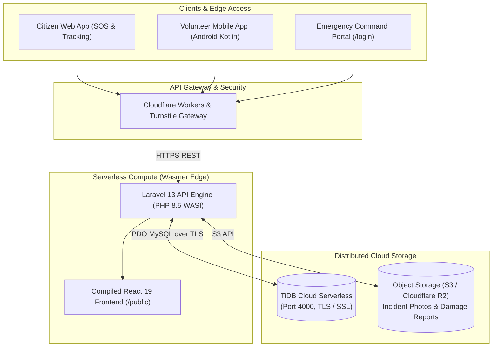

# Disaster Relief Management — Emergency Operations Command

[](https://github.com/spoorhisr-tech/Disaster-Webapplication/actions)
[](https://www.php.net/)
[](https://laravel.com)
[](https://react.dev/)
[](https://tidbcloud.com)
[](https://wasmer.io)
[](LICENSE)

A cloud-native, high-availability humanitarian disaster coordination system designed for rapid crisis response during cyclones, flash floods, earthquakes, and industrial emergencies. 

The platform bridges **affected citizens**, **relief organizations (NGOs, hospitals, triage units)**, **field volunteers**, and **incident commanders** into a unified real-time operational picture.

---

## 🌐 Live Deployments & Endpoints

| Resource | URL | Description |
| :--- | :--- | :--- |
| **Command Portal** | [https://webapp.wasmer.app/login](https://webapp.wasmer.app/login) | Web login with quick-fill demo credentials and role badges |
| **Operations Dashboard** | [https://webapp.wasmer.app/](https://webapp.wasmer.app/) | Operations Command Dashboard with interactive views |
| **REST API Base URL** | `https://webapp.wasmer.app/api` | Central REST API for mobile clients, citizen apps, and partner integrations |
| **Cloud Database** | TiDB Cloud Serverless (AWS Tokyo) | Distributed, MySQL-compatible relational cloud database (Port 4000, TLS encrypted) |
| **CI/CD Pipeline** | [GitHub Actions](https://github.com/spoorhisr-tech/Disaster-Webapplication/actions) | Automated test suite, container packaging, and continuous deployment |

---

## 👥 Team Roles & Responsibilities

| Role | Member | Responsibilities & Deliverables |
| :--- | :--- | :--- |
| **Member 1** | **Frontend & Citizen Interface** | • Citizen SOS emergency request form<br>• Real-time request tracking page (`REQ-XXXXXXXX`)<br>• Public evacuation shelter map & active disaster alerts<br>• Responsive web UI and API integration |
| **Member 2** | **Authentication & API Gateway** | • API Gateway proxy routing & rate limiting<br>• Cloudflare Turnstile anti-bot verification<br>• Role-based security policies & token validation<br>• Security compliance and traffic governance |
| **Member 3** | **Backend & Database**<br>*(Lead Backend Developer: Spoorthi S R)* | • **Laravel 13** backend architecture & REST APIs<br>• **TiDB Cloud** distributed database schema, relationships & seeders<br>• **Wasmer Edge** WebAssembly serverless deployment & package manifests<br>• Multi-tenant organization scoping (`/api/my-shelters`, `/api/my-resources`)<br>• **GitHub Actions CI/CD** pipeline with automated test suites & secret injection |
| **Member 4** | **Cloud Storage, Alerts & E2E Testing** | • S3 / Cloudflare R2 object storage for disaster damage photos<br>• Push/SMS emergency alert notifications for critical incidents<br>• Cloud latency, uptime & traffic monitoring<br>• End-to-end integration and API test suites |

---

## 🏛️ System Architecture



---

## 🗄️ Database Schema & Data Model

The database is built on **TiDB Cloud Serverless** and includes 13 tables managed through Laravel migrations:

```
├── users (id, name, email, password, role [admin|organization], organization_id, created_at)
├── organizations (id, name, type [ngo|hospital|government], registration_number, email, phone, area, status)
├── disaster_events (id, slug, title, type, severity, status, location_name, latitude, longitude, radius_km, affected_population)
├── shelters (id, shelter_name, area, capacity, current_occupancy, status, contact_person, contact_phone, organization_id)
├── emergency_requests (id, citizen_name, phone, area, latitude, longitude, urgency_level, resource_type, quantity, status, tracking_code)
├── requests (id, request_id, citizen_name, phone, area, urgency_level, resource_type_needed, quantity_needed, status)
├── resources (id, name, category, quantity, unit, location, status, organization_id)
├── distributions (id, disaster_event_id, resource_id, shelter_id, recipient_name, quantity_distributed, distribution_date, notes)
├── volunteers (id, name, email, phone, skills, status, availability, assigned_location)
├── incident_reports (id, disaster_event_id, reporter_name, reporter_contact, incident_type, severity, description, photo_path, location)
├── personal_access_tokens (Laravel Sanctum token authentication ledger)
├── cache & cache_locks (High-speed caching layers)
└── migrations (Database version control tracking)
```

---

## 📡 REST API Reference

Base URL: `https://webapp.wasmer.app/api`

### 1. Authentication
| Method | Endpoint | Description | Auth Required |
| :--- | :--- | :--- | :---: |
| `POST` | `/login` | Authenticate Admin or Organization coordinator; returns Bearer token | No |
| `POST` | `/logout` | Invalidate current Bearer token | **Yes** |
| `GET` | `/me` | Fetch authenticated user profile and linked organization details | **Yes** |

### 2. Emergency Requests (Citizen SOS & Tracking)
| Method | Endpoint | Description | Auth Required |
| :--- | :--- | :--- | :---: |
| `GET` | `/emergency-requests` | List all emergency requests with status and triage urgency | No |
| `POST` | `/emergency-requests` | Submit new emergency SOS request; returns unique tracking code | No |
| `GET` | `/emergency-requests/track/{code}` | Track live status of a request by tracking code (e.g. `REQ-20261102-WTR1`) | No |
| `PUT` | `/emergency-requests/{id}` | Update status (`PENDING`, `DISPATCHED`, `RESOLVED`) | **Yes** |

### 3. Relief Shelters
| Method | Endpoint | Description | Auth Required |
| :--- | :--- | :--- | :---: |
| `GET` | `/shelters` | List all evacuation shelters with capacity and current occupancy | No |
| `GET` | `/my-shelters` | List shelters managed by the authenticated organization | **Yes** |
| `POST` | `/shelters` | Register a new evacuation shelter | **Yes** |
| `PUT` | `/shelters/{id}` | Update shelter occupancy in real-time | **Yes** |

### 4. Warehouse Resources & Aid Distribution
| Method | Endpoint | Description | Auth Required |
| :--- | :--- | :--- | :---: |
| `GET` | `/resources` | View global emergency supply inventory | No |
| `GET` | `/my-resources` | View resources scoped to the authenticated organization | **Yes** |
| `POST` | `/resources` | Add emergency inventory items (water, rations, medical packs) | **Yes** |
| `GET` | `/distributions` | Fetch distribution ledger | No |
| `POST` | `/distributions` | Log an aid distribution event to a recipient | **Yes** |

### 5. Disaster Events & Incident Reports
| Method | Endpoint | Description | Auth Required |
| :--- | :--- | :--- | :---: |
| `GET` | `/disaster-events` | Fetch active disaster events (cyclones, floods, fires) | No |
| `POST` | `/disaster-events` | Declare a new disaster incident with GPS coordinates & radius | **Yes** |
| `GET` | `/incident-reports` | List field incident reports | No |
| `POST` | `/incident-reports` | Submit field damage report with description and coordinates | No |

### 6. Volunteers
| Method | Endpoint | Description | Auth Required |
| :--- | :--- | :--- | :---: |
| `GET` | `/volunteers` | View registered field responders | No |
| `POST` | `/volunteers` | Register a new volunteer with skills and assigned area | No |

---

## 🔑 Demo Accounts for Evaluators

The application includes pre-configured command accounts for immediate live evaluation at **[https://webapp.wasmer.app/login](https://webapp.wasmer.app/login)**:

| Role | Account Name | Email Address | Password | Permissions |
| :--- | :--- | :--- | :--- | :--- |
| **System Admin** | Disaster Relief Administrator | `admin@disaster-relief.org` | `Admin@123` | Full command access, disaster declarations, all shelters & supplies |
| **Organization** | Red Cross Field Coordinator | `coordinator@redcross.org` | `Redcross@123` | Scoped NGO access to Red Cross shelters, inventory, and triage |
| **Lead Admin** | Spoorthi (Administrator) | `spoorhisr@gmail.com` | `Admin@123` | Full administrative access |

> **Tip:** The login screen includes **Quick Fill Demo** buttons to auto-populate credentials with one click.

---

## 💻 Local Development Setup

### Prerequisites
- PHP 8.4+ with `pdo`, `pdo_mysql`, `mbstring`, `curl`, `openssl` extensions
- Composer 2.x
- Node.js 20+ & npm
- Git

### 1. Clone the Repository
```bash
git clone https://github.com/spoorhisr-tech/Disaster-Webapplication.git
cd Disaster-Webapplication
```

### 2. Backend Setup
```bash
cd app
composer install
cp .env.example .env
php artisan key:generate
```

### 3. Database Configuration
In `app/.env`, configure your database connection (TiDB Cloud or local MySQL):
```env
DB_CONNECTION=mysql
DB_HOST=gateway01.ap-northeast-1.prod.aws.tidbcloud.com
DB_PORT=4000
DB_DATABASE=test
DB_USERNAME=your-username.root
DB_PASSWORD=your-password
```

Run migrations and seeders:
```bash
php artisan migrate --seed
```

### 4. Frontend Build
```bash
cd ../frontend
npm install
npm run build
# Sync assets to Laravel public
Copy-Item -Path "dist/*" -Destination "../app/public" -Recurse -Force
```

### 5. Start the Application
```bash
cd ../app
php artisan serve
```
Open **[http://127.0.0.1:8000/login](http://127.0.0.1:8000/login)** in your browser.

---

## 🔄 CI/CD & Automated Deployment

The project employs an automated **GitHub Actions** pipeline ([`.github/workflows/ci-cd.yml`](.github/workflows/ci-cd.yml)) on every push to `main`:

1. **Continuous Integration (CI)**:
   - Sets up PHP 8.4 environment.
   - Installs dependencies via Composer with dependency caching.
   - Runs code quality analysis with Laravel Pint.
   - Executes automated PHPUnit feature and unit tests.
2. **Continuous Deployment (CD)**:
   - Authenticates with Wasmer via GitHub Secrets (`WASMER_TOKEN`, `TIDB_PASSWORD`).
   - Generates production `vendor/autoload.php` packages.
   - Auto-increments package versions in `wasmer.toml`.
   - Deploys headlessly to Wasmer Edge with zero downtime:
     ```bash
     wasmer deploy --non-interactive --no-wait
     ```

---

## 📄 License
This project is open-source under the [MIT License](LICENSE).
